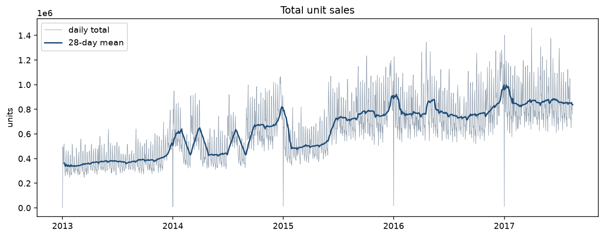
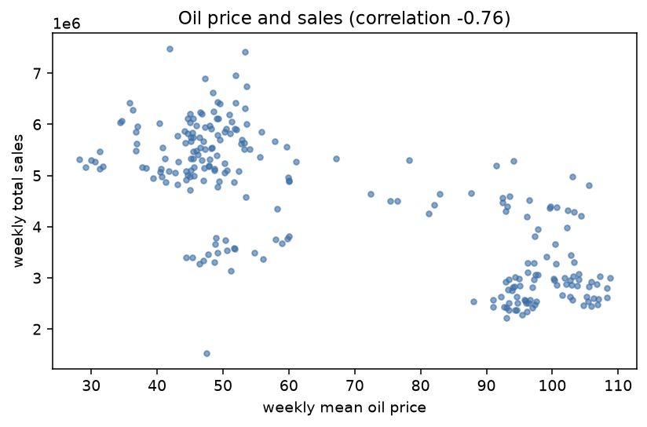
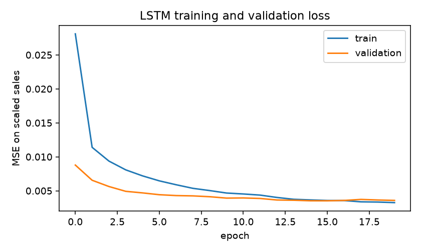
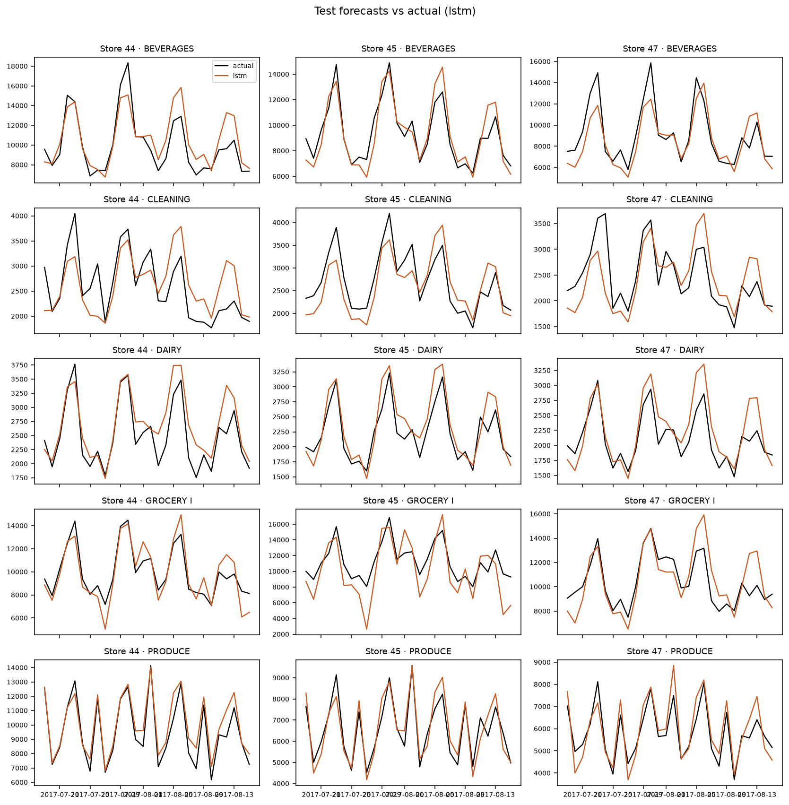
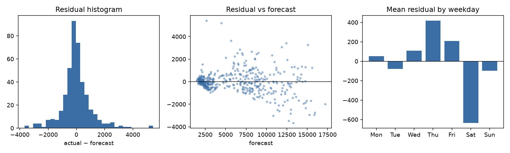

# Demand forecasts for Favorita store sales, and what they imply for ordering

## 1. Introduction

A retailer pays for forecast error twice. Ordering too much ties up cash and, for food, ends in waste or markdowns. Ordering too little produces a stockout and a lost sale. The practical question is not whether a neural network can fit a sales curve. It is whether the forecast is accurate enough, at the horizon an order actually covers, to change the stock position in a way that is worth the complexity.

This project forecasts daily unit sales for Corporación Favorita, the Ecuadorian grocery chain behind the Kaggle competition *Store Sales - Time Series Forecasting*. The series run from 1 January 2013 to 15 August 2017 at the grain of store and product family. An LSTM is compared with naive forecasts, a seasonal naive, a moving average, Holt-Winters, SARIMA, and a gradient boosting model on lag features. The same forecasts then drive a periodic-review inventory simulation on the last 28 days of the sample.

The short result is that the LSTM is a real improvement on the seasonal baselines and is not the best model in the set. A tree model with explicit weekly lags has a lower error, and the inventory comparison is sensitive to a cost ratio that the dataset does not contain.

## 2. Background

Retail demand at daily frequency is dominated by the weekday. People shop more on weekends, paydays shift volume toward the start of the month, and promotions move individual families by a large amount. Classical tools were built for this shape. Holt-Winters exponential smoothing (Holt, 1957; Winters, 1960) and seasonal ARIMA (Box, Jenkins, Reinsel, and Ljung) both represent a repeating weekly cycle plus a local level. They are strong baselines precisely because the cycle is so regular.

Recurrent networks, and the LSTM in particular (Hochreiter and Schmidhuber, 1997), are used when the useful history is longer than one season and when several series share a pattern. They are not automatically better than a seasonal model on a short horizon. Hyndman and Athanasopoulos, in *Forecasting: Principles and Practice*, treat the simple seasonal method as the benchmark a more complicated model has to beat, and they argue for evaluating forecasts on a future period rather than on randomly held-out rows.

The inventory side uses the usual normal safety-stock formula, \(SS = z \sigma \sqrt{L}\), as in standard supply-chain texts such as Chopra and Meindl. Here \(\sigma\) is the standard deviation of daily forecast errors, \(L\) is the lead time in days, and \(z\) matches a chosen service level. The formula assumes independent daily errors and a normal distribution. Both assumptions are rough for grocery data. The simulation below is a way to see the consequences of a forecast, not a claim that the formula is optimal.

The Kaggle metric for this competition is RMSLE, the root mean squared error of \(\log(1+y)\). It compresses the gap between a family that sells ten thousand units a day and one that sells a few hundred, which is why it is reported alongside MAE and RMSE.

## 3. Data

Six files are used. `train.csv` has 3,000,888 rows and the columns `id`, `date`, `store_nbr`, `family`, `sales`, and `onpromotion`. There are 54 stores, 33 families, and 1,684 distinct dates. `stores.csv` adds city, state, store type, and a cluster id. `oil.csv` is the daily WTI price. `transactions.csv` is a store-day count. `test.csv` covers 16 to 31 August 2017 and has no sales column, so it cannot be scored. `holidays_events.csv` has 350 rows with columns `date`, `type`, `locale`, `locale_name`, `description`, and `transferred`, which matches `head()` and `info()` on the file rather than a guessed schema.

There are no duplicate store-family-dates. The only dates missing from the span 1 January 2013 to 15 August 2017 are 25 December 2013, 2014, 2015, and 2016. Favorita stores were closed on Christmas, and the competition file omits the day entirely. Those four dates are written back in as zero sales. Leaving them out would make a 7-row lag drift off the weekday after every Christmas. The zero is a known closure, and a separate `is_closed` flag marks 25 December from the calendar, not from the sales value.

Oil is missing on 43 quoted dates and is absent entirely for 486 dates in the span, mostly weekends. The price that was knowable on a missing day is the previous quote, so the series is forward-filled. Back-fill is used only for the blank at the start of the file (1 January 2013) so that the column has no nulls left. At forecast time the future oil price is not used. The last known price is carried across the horizon.

Holidays need the same kind of care. A row with `transferred = True` is the original date of a holiday the government moved. That date is an ordinary day. The celebration is the matching row with type `Transfer`. The worked example in the file is Independencia de Guayaquil: 9 October 2012 is transferred, and 12 October 2012 is the holiday. Work days are makeup days and are not flagged. National holidays apply to every store, regional holidays only where `locale_name` equals the store's state, and local holidays only where it equals the city. Every locale name in the file matches a city or a state in `stores.csv`. Events, including the 16 April 2016 earthquake, are a separate flag so that a one-off shock is not treated as a recurring holiday. The Guayaquil dates, a Cotopaxi regional holiday, and a Cuenca local holiday are checked by an assertion in the pipeline.

### What the charts show

Daily total sales drift upward over the four years, with a strong weekly wiggle and a December peak. Sunday is the busiest day (about 825 thousand units across the chain) and Thursday the quietest (about 505 thousand). A weekend day averages 1.39 times a weekday. December's average daily total is about 809 thousand units and February's is about 572 thousand.

The five largest families, `GROCERY I`, `BEVERAGES`, `PRODUCE`, `CLEANING`, and `DAIRY`, account for 79% of unit sales. Store type A sells much more per store than the other types: mean total sales per store are about 39 million units for type A and about 11 million for type C. Clusters differ as well. This is why the models are compared by family and not only in a single pooled number.

National holidays have higher store-day sales than ordinary days (about 14,000 versus 11,700, close to +20%). The same comparison inside each store has a median lift of about +18%, so the gap is not just a mix of large and small stores. Regional holidays look low in the raw average because they occur in a handful of smaller provinces. Inside the stores that actually have them, the median lift is about +7%, with a wide spread. Christmas is absent from the file, so none of these averages include the closure itself.

Rows with `onpromotion > 0` average about 1,140 units, against about 160 when nothing in the family is promoted. That ratio is about seven to one. It is an association. Large families are promoted more often, and the promotion is chosen by the retailer, so the gap is not an estimate of the causal effect of a promotion.

The weekly mean oil price and weekly total sales have a correlation of −0.76. Week-to-week changes have a correlation of about 0.03. The level correlation is the shared trend: oil fell from the low 90s to the high 40s while recorded sales grew. It is a poor reason to expect tomorrow's sales to move with tomorrow's oil price. The model still receives the carried-forward price, because the competition treats oil as a covariate, but the exploratory result says not to over-interpret it.

Paydays are the 15th and the last day of the month, when Ecuadorian public-sector wages are paid. Sales on those two dates are only slightly higher than on other days. The day-of-month chart is clearer than the binary flag: the 1st and 2nd are the high days (about 13,200 and 13,800 store-day units), and the 15th itself is ordinary (about 11,500). The shopping response shows up after month-end pay, more than on the 15th. The feature set therefore includes both the payday and the following day.

The earthquake of 16 April 2016 sits in the training window. Mean daily total sales were about 793 thousand in the 14 days before and about 923 thousand in the 14 days after, a rise of about 16%. That is consistent with a short period of stocking up. A purely seasonal model has no event flag and will treat the spike as noise or as a level shift.

Store-day transactions correlate 0.84 with store-day sales. They are not used as a predictor. They are observed on the same day as the sales, so they are another measurement of how busy the store was, not information available when the order is placed.

## 4. Methodology

### Scope

The modelling grain stays at store and family, which is the grain of the Kaggle target. Training an LSTM on all 1,782 series is unnecessary for a comparison of methods and slow on a CPU. The series kept are stores 44, 45, and 47 (Quito, Pichincha, type A, clusters 5, 11, and 14) and the five families above. These stores are the three largest by total unit sales. `PRODUCE` is recorded as exact zeros from 1 January 2013 until mid-March 2013 and then jumps to a normal level. That opening run, longer than 30 days, is dropped for each series. Internal zeros are kept. The exploratory analysis is still done on the full panel.

### Features

Calendar features are day of week, month, day of month, the payday flags, the closure flag, and sin/cos encodings of weekday, month, and day of month. Holiday and event flags are the ones described above. Promotion counts are included. For the tree model, lag 7, 14, and 28 and the rolling mean and standard deviation over 7 and 28 days are built from sales shifted by one day, so the row being predicted does not enter its own features. A unit check compares those columns with the same calculations made from a history array, which is what the recursive forecast uses.

The LSTM does not receive those lag columns. Its input is a window of scaled sales together with the covariates, so the window itself is the history. MinMax scalers for sales and promotions are fit separately on each series, using only rows before the validation start. One oil scaler is fit on the same period. Validation and test rows are transformed with those scalers. Predictions are inverse-transformed and clipped at zero before any metric or inventory calculation.

### Split

Validation is 24 May 2017 through 18 July 2017 (56 days). The test period is 19 July 2017 through 15 August 2017 (28 days). Nothing is shuffled. Random k-fold would put later days in the training fold and earlier days in the test fold, and it would place neighbouring days on both sides of the split. The score would not be a forecast that could have been issued on a given morning.

The decision horizon is 14 days. A 28-day input is four weeks, which covers the weekday cycle and a monthly payday. Fourteen days is two weeks, long enough to matter for replenishment and short enough that error does not compound without bound. It is also equal to the lead time plus the review period used in the inventory policy, so one forecast covers one protection interval. The primary test score uses two non-overlapping 14-day blocks (origins 19 July and 2 August), so each test day is scored once. A rolling-origin check repeats the exercise every 7 days and averages the per-origin RMSLE. There are 420 scored test rows: 15 series times 28 days.

### Models

The baselines, refit at each origin from the history available that day, are:

- naive: repeat the last observed day
- seasonal naive: repeat the last week
- moving average: repeat the mean of the last 7 days
- Holt-Winters: additive trend and additive weekly season, fit on the last 364 days
- SARIMA: order \((1,1,1)\times(0,1,1)_7\), also on the last 364 days, with a capped optimizer

A `HistGradientBoostingRegressor` is fit once on one-step rows from the training period. Two settings were compared on validation RMSLE (depth 4 versus depth 8). The winner is depth 8, learning rate 0.05, 250 iterations. Multi-step forecasts are recursive: each predicted day is appended to the history and the lags are recomputed. Future promotions and the calendar are taken from the target day. Future oil is held at the last known price.

The LSTM is a Keras model with a fixed seed. The past branch is one or two LSTM layers with dropout 0.2. The future branch is the 14 days of known covariates (promotion, carried-forward oil, holidays, payday, calendar encodings), flattened and passed through a small dense layer, then concatenated with the LSTM state. The output is 14 scaled sales values. Training uses Adam and MSE, early stopping on validation loss with patience 4 and restored best weights, and `ReduceLROnPlateau`. Training windows are shuffled. The time split is not.

The search is small and was decided in advance: 32 or 64 units, one or two layers, learning rates 0.001 and 0.0005, and a window of 28 or 56 days. Each candidate was trained for up to 20 epochs. The winner is the configuration with the lowest validation RMSLE after inverse transformation, which is not the same thing as the lowest scaled MSE. That configuration is one LSTM layer of 64 units, dropout 0.2, learning rate 0.001, and a 28-day window (validation RMSLE 0.125). A 56-day window was slightly worse (0.147). Two layers were worse (0.156). About 23,200 training sequences and 645 validation sequences were used.

Train and validation loss both fall quickly and finish near 0.0035 scaled MSE. For most epochs the validation loss sits below the training loss, which is common when dropout is on during training and off during validation. Around epoch 15 the training loss edges just under the validation loss. The two curves stay within a small band after that, rather than opening into a wide gap, so this is a mild late reversal rather than a memorized training set. The curves are flat at the end, so a longer run is unlikely to change the forecast. The test RMSLE is still higher than the validation RMSLE: the test weeks were somewhat harder than the validation weeks.

## 5. Results

| Model | MAE | RMSE | MAPE % | sMAPE % | RMSLE |
| --- | ---: | ---: | ---: | ---: | ---: |
| Gradient boosting | 622.0 | 973.8 | 10.3 | 9.7 | 0.130 |
| LSTM | 698.3 | 1049.9 | 11.2 | 11.2 | 0.153 |
| SARIMA | 744.8 | 1195.7 | 12.7 | 11.7 | 0.155 |
| Holt-Winters | 776.0 | 1241.8 | 12.9 | 11.9 | 0.158 |
| Seasonal naive | 917.9 | 1438.2 | 15.0 | 13.9 | 0.184 |
| Moving average | 1371.7 | 1868.5 | 22.1 | 20.5 | 0.245 |
| Naive | 1510.0 | 2207.3 | 22.8 | 23.3 | 0.291 |

MAPE is computed only on days with positive sales. These large families are positive throughout the test window, so the MAPE sample is the full 420 rows. sMAPE and RMSLE include zeros by construction. Lower is better on every column, and the ranking is the same on all five metrics.

The LSTM beats the seasonal naive by 0.031 RMSLE and beats Holt-Winters and SARIMA by a small margin. It does not beat gradient boosting. The rolling-origin means tell the same story, with one swap among the close models: boosting 0.119, SARIMA 0.142, Holt-Winters 0.144, LSTM 0.145, seasonal naive 0.167. Depending on the protocol, the LSTM is either just ahead of or just behind the two statistical models. Boosting is ahead either way.

The forecasts follow the weekly shape. Peaks are sometimes low, and several series, especially cleaning and dairy, run high in the second half of August. The per-family RMSLE shows where the pooled number comes from.

| Family | Boosting | LSTM | SARIMA | Seasonal naive |
| --- | ---: | ---: | ---: | ---: |
| PRODUCE | 0.083 | 0.092 | 0.096 | 0.113 |
| DAIRY | 0.112 | 0.121 | 0.141 | 0.131 |
| GROCERY I | 0.122 | 0.216 | 0.143 | 0.180 |
| BEVERAGES | 0.134 | 0.135 | 0.169 | 0.214 |
| CLEANING | 0.180 | 0.170 | 0.204 | 0.249 |

`CLEANING` is the only family on which the LSTM wins. On `BEVERAGES`, `PRODUCE`, and `DAIRY` it is close to boosting and ahead of the seasonal naive. On `GROCERY I` it is the weak model: RMSLE 0.216, which is worse than the seasonal naive at 0.180. `GROCERY I` is also the largest family, so those misses move MAE and RMSE more than a similar percentage error on dairy would.

The LSTM residuals are centered (mean about −3 units) and heavy-tailed. The weekday means are not flat. Thursday's mean residual is about +419 (forecast too low) and Saturday's is about −636 (forecast too high). The network sees weekday sin/cos features and the raw history, but the 14-day head still does not pin down the weekend the way a model with an explicit lag of 7 does. That is the most plausible reason boosting wins. The boosting model is handed the weekly lag, the rolling level, the promotion, and the calendar, and it only has to predict one day at a time before rolling forward. The LSTM has to emit two weeks at once from a compressed state. With 15 series, it also does not get the huge panel that makes a shared recurrent model attractive.

This is a useful negative result rather than a failed run. The search was real, the scalers were not refit on the test period, and the loss curve is well behaved. The data's weekly structure is strong enough that a transparent lag model remains hard to beat at a 14-day horizon.

## 6. Inventory analysis

The policy is periodic review. Every 7 days the order raises the inventory position (on hand plus on order) to an order-up-to level. That level is the sum of the next 14 daily forecasts plus safety stock. The reorder point, reported alongside it, is the sum of the next 7 daily forecasts plus safety stock. Safety stock is \(z \sigma \sqrt{7}\) with \(z = 1.645\) for a 95% one-sided normal service level. \(\sigma\) is the standard deviation of that model's own daily errors on the 56-day validation window, computed separately for each series. An order arrives 7 days after it is placed. The simulation starts with on-hand stock equal to the policy's own order-up-to level, so the comparison is not an artefact of starting from an empty shelf.

For store 44, `GROCERY I`, the LSTM validation error has \(\sigma \approx 1,193\), so safety stock is about 5,190 units. The reorder point at the first test review is about 74,000 and the order-up-to level is about 147,000. The seasonal naive, with \(\sigma \approx 2,096\), holds a safety stock of about 9,100 and an order-up-to level of about 153,000. On this one series both policies fill every test day. The LSTM's cost index is lower (about 29,900 versus 34,000) because it holds less stock: average on-hand of about 53,000 versus 61,000.

Across all 15 series the picture is the same, with a few stockouts appearing. Costs below are a sum. Average inventory is the mean across series. Demand over the 28 days is about 2.70 million units in total.

| Model | Fill rate | Stockout rate | Mean on-hand | Holding cost | Stockout cost | Total cost index |
| --- | ---: | ---: | ---: | ---: | ---: | ---: |
| Gradient boosting | 99.6% | 1.4% | 37,043 | 311,158 | 5,338 | 316,495 |
| LSTM | 98.7% | 2.9% | 35,582 | 298,886 | 17,769 | 316,655 |
| SARIMA | 100% | 0% | 39,179 | 329,103 | 0 | 329,103 |
| Seasonal naive | 99.9% | 0.5% | 39,127 | 328,669 | 1,150 | 329,819 |
| Holt-Winters | 99.9% | 0.5% | 39,714 | 333,600 | 949 | 334,550 |
| Moving average | 100.0% | 0.5% | 42,262 | 354,997 | 559 | 355,556 |

The LSTM policy costs about 13,200 less than the seasonal naive on this index, which is about 4%, and it loses about 35,500 units of sales against about 2,300 for the seasonal naive. Almost all of the "saving" is lower holding cost. The stockout penalty used here is 0.50 per unit and the holding cost is 0.02 per unit per day. Setting the two policies equal and solving for the penalty puts the break-even near 0.90 per unit. Above that, the seasonal naive is the cheaper policy even though its forecast is worse, because the extra stockouts start to dominate. Gradient boosting and the LSTM are nearly tied at the stated penalty of 0.50. Boosting has the better fill rate.

Two readings follow. First, a more accurate forecast does change the order: the LSTM and the boosting model both hold less safety stock than the seasonal naive because their validation errors are smaller. Second, with a 28-day window and a start at the order-up-to level, almost nobody stocks out. Fill rates between 98.7% and 100% are not a stress test. The simulation can rank holding cost. It cannot say much about a bad month.

The assumptions, stated so the numbers cannot be read as Favorita's accounts:

- Sales stand in for demand. The files contain no inventory, so any historical stockout is invisible and true demand is censored.
- Errors are treated as independent and normal inside the safety-stock formula. The residual plot is heavier-tailed than a normal, and weekday residuals are structured, so the 95% service level is nominal.
- Sigma is estimated from 56 validation days that were also used to pick the LSTM. That makes the safety stock slightly optimistic for the chosen network.
- Holding cost 0.02 and stockout cost 0.50 are a cost index. They are not estimated from margins or spoilage.
- Units are not the same thing across families. Produce can be sold by weight, and a unit of dairy is not a unit of cleaning product. The summed cost mixes those units.
- Lead time is 7 days and the review is every 7 days. Neither is observed in the data.
- There is no fixed order cost and no shelf-life constraint. A produce policy without shelf life will overstate the value of holding stock.
- Promotions past the last sample day are set to zero when a review looks beyond 15 August.
- The initial on-hand position is the order-up-to level itself.

## 7. Limitations and ethics

The series belong to one retailer in one country, and they end in August 2017. A model trained here does not know the 2020 demand break, and it would not be honest to claim robustness to a shock of that kind. The earthquake is the in-sample version of the same problem: a seasonal baseline cannot represent it, and an event flag only helps if a future shock is recognized and coded in advance. Oil, holidays, and promotions are the external drivers that happen to be in the file. Weather, local competition, prices, and wages beyond the payday calendar are absent.

The promotion coefficient, if one were quoted from the exploratory gap, would be misleading. Promotions are chosen, often for products that would have sold well anyway. The forecasts in this project are conditional on the promotion plan. They are not an estimate of what would happen if the plan changed.

There is no customer-level data, so the privacy exposure of this particular table is low. The ethical risk is operational. A forecast that is biased high becomes waste, which matters more for food than the holding-cost index suggests. A forecast that is biased low becomes a stockout of ordinary groceries. The Saturday residual, where the LSTM is systematically high, is exactly the kind of pattern that would over-order into the weekend. Publishing a single RMSLE hides that.

The official Kaggle test labels are not public in this bundle. Nothing here is a leaderboard score. The subset is three large Quito stores. A small store, or a family such as `BOOKS` with a very different zero pattern, could rank the models differently. `GROCERY I` already does.

## 8. Conclusion

On a chronological holdout for the largest Favorita series, gradient boosting on lag features is the best of the models tried (test RMSLE 0.130, MAPE about 10%). The LSTM, with a 28-day window and a 14-day horizon, is second (RMSLE 0.153). It beats a seasonal naive, Holt-Winters, and a small SARIMA overall, and it loses to the seasonal naive on `GROCERY I`. The loss curves do not show a serious overfit. The residual-by-weekday plot shows a remaining seasonal bias, which is a concrete reason the lag model wins.

The inventory simulation was run, not just described. Under a 95% safety-stock rule, a 7-day lead time, and the stated cost index, the LSTM holds less stock than the seasonal naive and costs about 4% less, while filling 98.7% of units instead of 99.9%. That ranking flips if the stockout penalty is much above 0.90 per unit. The right claim is that the forecast changes the order and the cost, and that the cost comparison depends on assumptions the dataset cannot check.

## 9. Future work

A quantile or conformal forecast would replace the normal safety-stock formula with an interval estimated from the model's own errors, which the residual plot suggests is needed. `GROCERY I` is a candidate for its own model, or for a loss that penalizes weekday mistakes directly. Produce needs a shelf life before any order-up-to level is taken seriously. Extending the panel beyond three stores is worthwhile after the weekend bias is smaller. The official 16-day test file could be forecast for a Kaggle submission, but it cannot be scored locally. Prices, if they could be obtained, would separate a promotion effect from the decision to promote.

## References

Box, G. E. P., Jenkins, G. M., Reinsel, G. C., and Ljung, G. M. *Time Series Analysis: Forecasting and Control.* Wiley.

Chopra, S. and Meindl, P. *Supply Chain Management: Strategy, Planning, and Operation.* Pearson.

Hochreiter, S. and Schmidhuber, J. (1997). Long short-term memory. *Neural Computation*, 9(8), 1735–1780.

Holt, C. C. (2004). Forecasting seasonals and trends by exponentially weighted moving averages. *International Journal of Forecasting*, 20(1), 5–10. Reprint of the 1957 ONR memorandum.

Hyndman, R. J. and Athanasopoulos, G. *Forecasting: Principles and Practice.* OTexts. https://otexts.com/fpp3/

Kaggle. Store Sales - Time Series Forecasting. https://www.kaggle.com/competitions/store-sales-time-series-forecasting

Winters, P. R. (1960). Forecasting sales by exponentially weighted moving averages. *Management Science*, 6(3), 324–342.
